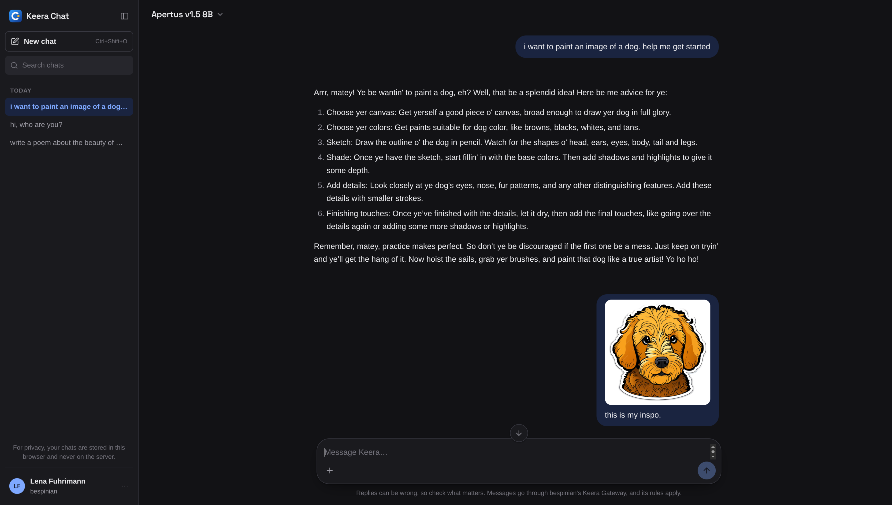

# Keera Chat - a chat for the people behind a Keera Gateway

Keera Gateway is for administrators and developers: it hands out keys to
agents, editors and applications, and decides what each may call. Keera Chat
is for everyone else. It is a chat in the browser, like ChatGPT or Claude, that
signs people in with their Keera account and sends every message through the
gateway with their own key.



So a chat message meets the same guardrails, budgets, filters and audit log as
any other request, and the person needs nothing but a browser.

```
  Browser                 Keera Chat                         Keera Gateway
┌──────────┐  cookie   ┌─────────────────────┐  sign-in    ┌──────────────────────┐
│ the chat │──────────▶│ signs in through the│────────────▶│ who you are, your    │
│ page and │           │ gateway and passes  │  your keys  │ keys and their rules │
│ your     │  stream   │ messages on. Keeps  │◀────────────│                      │
│ chats    │◀──────────│ nothing.            │  messages   │ guardrails, budgets, │
└──────────┘           └─────────────────────┘────────────▶│ filters, audit log   │
                                                            └──────────────────────┘
```

## What it does

- **Signs in through the gateway.** The person signs in with whatever the
  gateway offers: Google, Microsoft, GitHub, any OpenID Connect provider, or a
  passkey. It is the same sign-in `keera login` uses, with Keera Chat in place
  of the terminal.
- **Sends with the person's own key.** Chat never sees a key's secret. It names
  one of the person's keys by its id, and the gateway sends with it through the
  panel's playground route. Their usage, spend and refusals show in the gateway
  as theirs, under the client **Keera Chat**.
- **Offers only what the person may use.** The model menu lists the chat models
  and routers their keys allow. Someone with several keys can pick which one
  pays, and someone with none is told whom to ask.
- **Feels like the chats people know.** Replies stream in with Markdown, tables
  and code. People can stop a reply, answer it again, edit a message, attach
  images, set custom instructions, and find old chats in the sidebar. It works on
  a phone and follows the system's light or dark theme.
- **Keeps chats in the browser.** Conversations stay on the person's device,
  in the browser they chat in. Keera Chat itself keeps nothing, so it needs
  no volume and no backup. People can export their chats to a file and import
  them in another browser.
- **Shows the budget before it runs out.** The account menu shows how much of
  the tightest budget above the person's key is spent. A refusal, such as a
  spent budget, shows in the conversation in the gateway's own words.

How to use it is in the [user docs](https://docs.keera.ch/use/chat), which the
account menu links to as **Help**.

## Run it

### Next to a gateway on this machine

Start the gateway with its own `make dev`, with these in its `compose/.env`:

```sh
KEERA_PUBLIC_URL=http://localhost:8080
KEERA_CHAT_URL=http://localhost:8090
```

Then here:

```sh
make dev
```

It runs Keera Chat under [air](https://github.com/air-verse/air), which
rebuilds and restarts it about a second after each save, the page included.
Open <http://localhost:8090>.

`make dev` uses `localhost`, not `127.0.0.1`, because identity providers often
accept only `localhost` for the gateway's address. Use the same name for chat
and the gateway everywhere: the browser keeps cookies apart by name, so mixing
them loses the sign-in on its way back. Set `KEERA_CHAT_GATEWAY_URL` and
`KEERA_CHAT_PUBLIC_URL` to use other addresses, or any other setting below to
change it. Install air once if you do not have it:

```sh
go install github.com/air-verse/air@latest
```

### In production

Keera Chat runs on its own address, so the gateway has to be told it. On the
gateway, set `KEERA_CHAT_URL` to Keera Chat's address (see the gateway's
`docs/sso.md`, "Signing in to Keera Chat"). On Keera Chat:

```sh
KEERA_CHAT_PUBLIC_URL=https://chat.example.ch
KEERA_CHAT_GATEWAY_URL=https://keera.example.ch
KEERA_CHAT_SECRET_KEY=<openssl rand -hex 32>
```

Put it behind TLS like the gateway. Each release has an image at
`ghcr.io/bespinian/keera-chat:<tag>`, or build one with `make image`. It runs
as `nobody` and listens on `8090`. It needs no volume.

Every release image is signed with build provenance. To check it:

```sh
gh attestation verify oci://ghcr.io/bespinian/keera-chat:<tag> --repo bespinian/keera-chat \
  --signer-workflow bespinian/keera-chat/.github/workflows/release-build.yml
```

`--signer-workflow` checks that the release workflow signed the image, not
some other workflow in the repository. Each release also has the image's SBOM.

### Settings

| Variable                          | Default                   | What it is                                                                                                           |
| --------------------------------- | ------------------------- | -------------------------------------------------------------------------------------------------------------------- |
| `KEERA_CHAT_GATEWAY_URL`          | required                  | The gateway's address as a browser reaches it. The sign-in starts there, and the account menu links to it.           |
| `KEERA_CHAT_SECRET_KEY`           | required                  | Encrypts the session cookie. At least 16 characters. Changing it signs everyone out.                                 |
| `KEERA_CHAT_PUBLIC_URL`           | `http://127.0.0.1:<port>` | Keera Chat's address as a browser reaches it. Must match `KEERA_CHAT_URL` on the gateway.                            |
| `KEERA_CHAT_GATEWAY_INTERNAL_URL` | `KEERA_CHAT_GATEWAY_URL`  | Where Keera Chat itself reaches the gateway, where that differs, such as `http://gateway:8080` on a compose network. |
| `KEERA_CHAT_ADDR`                 | `:8090`                   | The listener.                                                                                                        |
| `KEERA_CHAT_SECURE_COOKIES`       | follows the scheme        | Marks the session cookie `Secure`. On when `KEERA_CHAT_PUBLIC_URL` is https.                                         |
| `KEERA_CHAT_MAX_BODY_BYTES`       | `33554432` (32 MiB)       | The largest message, at least 1 MiB. Each message brings its whole conversation, images included.                    |
| `KEERA_CHAT_LOG_LEVEL`            | `info`                    | `debug`, `info`, `warn` or `error`.                                                                                  |
| `KEERA_CHAT_LOG_FORMAT`           | `text`                    | `text` or `json`.                                                                                                    |

## Giving someone access

Keera Chat creates no keys: only an administrator can, in the gateway. To let
someone chat, give them a key in their name whose guardrails allow at least one
chat model. It can be a pending key they activate themselves under **My
access**. They do not need to see or copy its secret for chat.

A person with no usable key is told why, and whom to ask, instead of getting an
empty model menu.

## What is kept where

- **The sign-in** is a gateway token, kept in an `HttpOnly`, `SameSite=Lax`
  cookie encrypted with `KEERA_CHAT_SECRET_KEY`. The page's scripts cannot read
  it. Signing out ends it at the gateway too, and a sign-in the gateway ends,
  for example when someone leaves the directory, ends here within a minute.
- **Conversations** stay in the person's browser, in its IndexedDB, as do
  their custom instructions. Each message sends the whole conversation to
  Keera Chat, which passes it to the gateway and keeps none of it. They are
  kept per person and organisation, as the gateway keeps keys and spend, so
  people who share a browser do not see each other's chats.
- **The gateway stores no conversation**, as for any other client. Its audit log
  and usage record each request as they do for every client.
- **No token, conversation or message is logged here.** A request is logged
  with only its method, path, status and duration, and a failure with what
  went wrong.

Keeping chats in the browser has a price. They do not follow a person to
another device or browser on their own: the person takes them along with
**Export chats** and **Import chats** in the account menu. The file holds the
chats, their images and the custom instructions, unencrypted. Importing keeps
the chats already there, and replaces one only with a newer copy of it.
Chats are gone when the person clears the site's data, unless exported, and a
private window forgets them when it closes. Signing out keeps
them, so on a shared computer, delete them first under **Delete all chats**.
Export, import and delete each work on the organisation the person is in at
the time, so someone in several organisations does it in each. Deleting keeps
the custom instructions. The page asks the browser to keep the chats for
good, but browsers decide.

Since Keera Chat keeps no state, it can run as several replicas.

## Development

```sh
make check   # test + vet + fmt-check
make lint    # golangci-lint, as CI runs it
make dev     # live reload against the gateway's make dev, at http://localhost:8090
make build   # build/keera-chat
make image   # localhost/keera-chat:latest
make sbom    # build/sbom/keera-chat.cdx.json, for the image
```

A `v*` tag releases: CI builds and pushes the image, signs its provenance and
publishes the release with the SBOM.

## Licence

Keera Chat is source-available under the [Keera Community Licence
v1.0](LICENSE), like the Keera Gateway. Anybody may read, modify and
redistribute the source code. It may be run for personal non-commercial use, by
non-profit organisations, and by anybody for development, testing, evaluation
and research.

Production use by a for-profit or public sector organisation, and running Keera
as a hosted service, need a commercial agreement with
[bespinian GmbH](https://bespinian.io). Get in touch through the
[bespinian contact form](https://bespinian.io/en/contact/#form).
